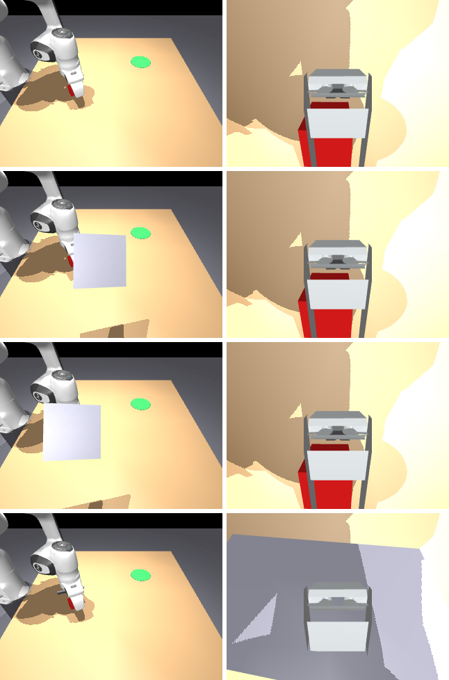

# OccluBench

**A GPU-native benchmark for how vision-language-action (VLA) policies cope when a physical object moves into a camera's view mid-episode.**

Policies see only RGB from a **wrist** camera and a **third-person** camera, plus proprioception. During an episode, a real
simulated object (a mocap plate, rendered by every camera) slides into the line of sight of one camera, hides a calibrated
fraction of the task object, holds, and slides out. Every perturbed rollout is paired with a clean rollout from the
identical initial state, and results are reported with bootstrap 95% confidence intervals.

> **Status: v0.3.** Two robots: the Franka Panda from MuJoCo Menagerie (fetched at runtime) and a simple gantry. On the
> Warp path, occluder placement, calibration, coverage and success run as Warp kernels; IK is still batched NumPy on the
> host. An OpenVLA-OFT adapter is included (tested in CI in mock mode only). Everything is tested on CPU and on Warp's CPU
> device. **No NVIDIA GPU numbers yet** and **no VLA has been evaluated yet**: run
> [`scripts/brev_run.sh`](#gpu-runs-nvidia-brev-h100--a100) to produce GPU numbers. See [Roadmap](#roadmap).




*Rows: clean; third-person 50%; third-person 100%; wrist 100%. Left: third-person camera. Right: wrist camera. CPU
renderer. Top: gantry. Bottom: Franka Panda.*

## Why this benchmark

Most VLA benchmarks already feed policies cameras plus proprioception, so "camera-only" is not new. What is new here:

1. **A moving, physical occluder introduced mid-episode.** Not a static occluder present from reset, not an image-space
   mask, and not a dropped camera feed. Because it is a physical object, it can also partly block the *other* camera;
   OccluBench measures that leakage (`coverage_other`) instead of hiding it.
2. **A factorial grid of camera × severity × onset** (plus duration). Severity is calibrated per episode, by bisection on
   segmentation renders, to a target fraction of the task object's pixels hidden in the chosen camera.
3. **Paired, seeded rollouts at GPU scale with CIs.** Clean and perturbed rollouts share the same seed and initial state.
   The paired scoring follows MAIL-Bench (arXiv:2609.35003). The physics and renderer run on MuJoCo Warp so that thousands
   of pairs per cell are affordable.

### Positioning

| Work | What it perturbs | Mid-episode? | Physical occluder? | Camera × severity × timing grid | Sim | Paired + CIs |
|---|---|---|---|---|---|---|
| LIBERO-plus ([2510.13626](https://arxiv.org/abs/2510.13626)) | layout/distractors, camera pose, init state, language, light, texture, sensor noise | no | no | no | LIBERO (CPU) | no |
| LIBERO-PRO ([2510.03827](https://arxiv.org/abs/2510.03827)) | objects, init states, instructions, environments | no | no | no | LIBERO (CPU) | no |
| LIBERO-Occ ([2606.10862](https://arxiv.org/abs/2606.10862)) | scene-induced occlusion, light/medium/heavy | no (placed at reset) | yes, static | severity only | LIBERO (CPU) | no |
| LIBERO-VPro ([2609.24350](https://arxiv.org/abs/2609.24350)) | masking (25–100%, 4 temporal schedules), blackout/noise, staleness, view loss, cross-view contradiction | yes | no (masking) | partial | LIBERO (CPU) | no CIs reported |
| MAIL-Bench ([2609.35003](https://arxiv.org/abs/2609.35003)) | camera-group loss (wrist / third-person / all) at 30/45/60% of completion | yes | no (dropout) | camera × timing | RoboCasa365 | yes (bootstrap) |
| BAVO-Bench ([2609.37292](https://arxiv.org/abs/2609.37292)) | stage / random-time occlusion with active viewpoint recovery | yes | — | no | AV-ALOHA (bimanual) | — |
| MIKASA-Robo-VLA ([2610.00604](https://arxiv.org/abs/2610.00604)) | memory: cues hidden before the action that needs them | yes | task-specific | no | ManiSkill 3 | — |
| **OccluBench (this)** | moving physical occluder in front of one camera | **yes** | **yes, moving** | **camera × severity × onset (× duration)** | **MuJoCo Warp (GPU) / MuJoCo (CPU)** | **yes** |

"—" means not characterised here. These rows summarise each paper as we read it; corrections are welcome via issues.

## Robots

| `robot=` | Model | Action `(N, dim)` | Notes |
|---|---|---|---|
| `"panda"` | Franka Emika Panda from [MuJoCo Menagerie](https://github.com/google-deepmind/mujoco_menagerie/tree/main/franka_emika_panda), **Apache-2.0**, fetched at runtime and not vendored | 7: tcp xyz + roll/pitch/yaw (world, rad; `(pi, 0, yaw)` = gripper down) + grip in [-1, 1] | Batched damped-least-squares IK to the 7 joint position actuators, with a null-space posture term. The Menagerie gripper actuator is unchanged. |
| `"gantry"` (default) | Self-authored Cartesian x/y/z gantry with a parallel gripper | 4: tcp xyz + grip | Fast and simple; used by the CPU CI tests. |

The Panda is fetched on first use: a sparse git checkout of Menagerie at a pinned commit (`occlubench/menagerie.py`) into
`~/.cache/occlubench` (override with `$OCCLUBENCH_CACHE`). Set `$OCCLUBENCH_MENAGERIE` to use an existing checkout. Run
`python -m occlubench.menagerie` to prefetch. The Menagerie LICENSE file is fetched with the model.

Proprioception: gantry `(N, 5)` = tcp xyz, finger opening, grip command. Panda `(N, 12)` = the same plus 7 joint angles.

Scripted oracle success rates (CPU, horizon 200, seeds 0–255): gantry 256/256; Panda 256/256. v0.2's two Panda failures
were a yaw-wrap bug in the oracle (fixed in v0.3). `tests/test_panda.py` requires all of seeds 30–53 to succeed.

## Install

```bash
pip install -e ".[dev]"            # CPU: mujoco + numpy, plus pytest/ruff/pillow
pip install -e ".[dev,warp]"       # + MuJoCo Warp (GPU physics and batch renderer)
```

CPU rendering needs an OpenGL backend: `MUJOCO_GL=egl` with a GPU, or `MUJOCO_GL=osmesa` (`apt install libosmesa6`) on
headless CPU machines.

## Quick start

```python
from occlubench import OccluEnv, Condition, condition_grid, run_paired, summarize
from occlubench.metrics import format_table
from occlubench.policies import ColorCuePolicy

conds = condition_grid(cameras=("third_person", "wrist"), severities=(0.5, 1.0), onsets=(0.0, 0.15))
records = run_paired(ColorCuePolicy, conds, seeds=range(32), n_envs=16, image_size=(64, 64))
print(format_table(summarize(records)))
```

Or from the command line: `python scripts/run_grid.py --policy colorcue --seeds 32 --n-envs 16`.

### Environment API

* `OccluEnv(n_envs, horizon=200, image_size=(96, 96), physics="cpu"|"warp", render="cpu"|"warp"|"none", robot="gantry"|"panda", device_ops=None)`
  (`device_ops` defaults to on with `physics="warp"`; `False` forces the NumPy reference for the occluder/scoring step)
* `reset(seeds, conditions)` → `obs`; `step(actions)` → `obs, done, info`
* `obs["rgb"]["third_person"]`, `obs["rgb"]["wrist"]`: `(N, H, W, 3)` uint8. `obs["proprio"]`: `(N, 5)` tcp xyz, finger
  opening, grip command.
* Action: see [Robots](#robots). `env.robot.default_action(xyz, grip, yaw)` builds one for either robot.
* `info["success"]`: the cube rests within 5 cm of the goal centre. `env.success_step` records the first success step.
* `env.privileged()` returns ground-truth state, for the scripted oracle and for scoring only. Submissions must not use it.
* `env.camera_calibration(cam)` returns intrinsics and extrinsics, as a calibrated real rig would provide.

### Conditions

`Condition(camera, severity, onset, duration, anchor="camera"|"world")`:

* `camera`: `"third_person"`, `"wrist"`, or `"none"` (clean).
* `severity`: target fraction of task-object pixels hidden in that camera.
* `onset`, `duration`: fractions of the horizon.
* `anchor`: `"camera"` re-aligns the occluder to the camera→object ray every step, so target-camera severity stays
  constant. `"world"` freezes its pose in the world at onset.

The occluder slides in over 8 control steps, holds for `duration`, and slides out.

Severity is calibrated at onset by a batched bisection on the lateral offset. Coverage uses a vectorised geometric
estimator (`occlubench/geometry.py`). It casts rays from the camera to cube-surface samples, weights them by projected
area, and tests them against the occluder plate, for all envs at once on either backend. It agrees with CPU segmentation
renders to within 0.08 (`tests/test_geometry.py`, typically within 0.04). Coverage is tracked in **both** cameras on every
step the occluder is in the scene. See [docs/leakage_analysis.md](docs/leakage_analysis.md) for why that matters.

### Metrics (per condition, 95% percentile bootstrap over seeds)

| Metric | Definition |
|---|---|
| `paired_drop` | mean(clean success − perturbed success) over paired seeds |
| `conditional_success` | P(perturbed success \| clean success) (MAIL-Bench-style) |
| `recovery_steps` | mean extra steps to success (perturbed − clean) when both succeed |
| `coverage`, `coverage_other` | mean hidden fraction while the occluder is in the scene, in the targeted camera and (leakage) in the other camera |
| `coverage_other_max`, `coverage_onset` | worst-step leakage; target-camera coverage at onset (the calibrated value) |

## Reference policies

* `ScriptedOracle` uses privileged state, including cube yaw for aligning the grasp. It is blind to occlusion by
  construction, so its paired drop should be 0. It is a pipeline check, not a baseline.
* `ColorCuePolicy` uses pixels and proprioception only, and is not learned. It finds the red cube in one camera by colour
  thresholding and back-projection, then runs a pick-and-place script. With `memory=False` it waits while the cube is
  hidden. It gives the grid a non-trivial signal on CPU.
* `OpenVLAOFTPolicy` adapts OpenVLA-OFT: `backend="hf"` (transformers, lazy import), `backend="oft"` (the openvla-oft
  loaders with the L1 action head and proprio projector), or `backend="mock"` (CI). Configurable model id, action
  chunking, bounds unnormalisation, gripper convention. Not yet run end to end on a GPU; released checkpoints target
  LIBERO, so fine-tune first. See [docs/openvla_oft.md](docs/openvla_oft.md).

## GPU runs (NVIDIA Brev, H100 / A100)

On a fresh NVIDIA Brev H100 80GB or A100 80GB instance (Ubuntu + NVIDIA driver):

```bash
git clone https://github.com/dundysm/occlubench && cd occlubench
bash scripts/brev_run.sh
# -> results/brev_<UTC timestamp>/results.md and results.json  (paste these back)
```

The script does the following:

* creates `.venv` and runs `pip install -e ".[dev,warp]"`
* prints the GPU, MuJoCo and Warp versions, and prefetches the Panda
* runs `scripts/smoke_test.py` at 64/128/256/512 envs (128×128, both cameras, Warp physics and Warp batch renderer) for
  both robots
* runs a small paired grid (ColorCue, gantry, 256 seeds × 8 conditions)
* writes JSON and Markdown

Overrides: `ROBOT=panda`, `ENVS="256 1024"`, `IMAGE="96 96"`, `GRID_SEEDS=1024`.

What runs where on the Warp path, per control step:

* **Physics and rendering stay on the device.** The env runs `mjw.step` × substeps, then `mjw.kinematics`, `camlight`,
  `com_pos`, and `jac` at the tcp.
* **Occluder and scoring stay on the device** (`occlubench/warp_ops.py`): one kernel places the occluder (including
  onset calibration by bisection), writes its mocap pose into Warp Data and accumulates two-camera coverage; another
  tracks success. These reach the host only when `env.success_step`, `env.coverage_stats()` or an `info` value is read.
  Parity with the NumPy reference is tested (`tests/test_warp_ops.py`).
* **Still copied each step, for IK on the host:** qpos, tcp pose, and the tcp Jacobian (Panda), plus cube/camera poses
  for `privileged()`/`camera_calibration()`. **ctrl goes back to the device.**
* **Images are copied to the host only when observations are built**, because policies currently run on the host.
  A Warp IK kernel and on-device policies (for example torch over DLPack) are next.

Measured on a CPU-only box (no GPU), CPU backend: gantry ~23 env-steps/s with two 96×96 CPU-rendered cameras. Physics
only: gantry ~1,000 env-steps/s and Panda ~3,400 env-steps/s at 64 envs. CPU OSMesa rendering of the Panda meshes is
slow (~4 env-steps/s). No GPU numbers have been measured yet.

## Scene

`occlubench/assets/scene_base.xml` (self-authored, MIT) contains:

* a table with a red 4 cm cube (seeded pose) and a green goal disc
* a fixed `third_person` camera
* a collision-free mocap occluder plate

The robot is attached with `MjSpec.attach` at load time. It is either `assets/gantry.xml` (self-authored) or the Menagerie
Panda, which gets a tcp site and a `wrist` camera added to its hand at runtime. No third-party assets are vendored.

Known quirk: with `MUJOCO_GL=osmesa`, creating CPU renderers for two *different* models in one process can return
garbage. The Panda tests therefore run in a separate pytest invocation.

## Development

```bash
MUJOCO_GL=osmesa pytest -q                      # gantry + Warp-backend tests (Warp runs on its CPU device)
MUJOCO_GL=osmesa pytest -q -m panda -o addopts=  # Panda tests, separate process (fetches Menagerie)
ruff check . && ruff format --check .
python scripts/render_docs.py   # regenerates docs/images
```

CI (GitHub Actions) runs ruff, the CPU tests, the Panda tests and the Warp-backend tests (on Warp's CPU device) on every push to main and every PR. Example CPU grid output: [docs/results_v0_cpu.md](docs/results_v0_cpu.md).

## Roadmap

- [x] v0.2: batched occluder, coverage, success and IK; no per-env host kinematics on the Warp path; Menagerie Panda with
      IK; per-step leakage tracking; `brev_run.sh`.
- [x] v0.3: Warp kernels for occluder placement, calibration, coverage and success (NumPy fallback, parity tests);
      OpenVLA-OFT adapter (hf / oft / mock backends); Panda oracle fixed (256/256 on CPU).
- [ ] **GPU numbers:** run `brev_run.sh` on an H100/A100 and publish throughput and memory against `n_envs` and resolution.
- [ ] **Fully on-device step:** a Warp IK kernel; on-device policies via DLPack; optional Warp-segmentation coverage.
- [ ] **First VLA numbers:** run the OpenVLA-OFT adapter end to end on a GPU, zero-shot and after fine-tuning.
- [ ] **More tasks:** LIBERO-style tasks for the Panda (drawer, stacking); joint torque or OSC control modes.
- [ ] **Occluder families:** world-fixed occluders (for example a person or arm passing by), moving clutter, and partial
      transparency. Static (LIBERO-Occ-style) and dropout (MAIL-Bench-style) controls are included for comparison.
- [ ] **Demos:** a GPU scripted-demo generator, including occlusion-during-demo variants, exported to LeRobot/RLDS.
- [ ] **Baselines:** OpenVLA-OFT and pi0/pi0.5 fine-tuned on OccluBench demos, plus wrist-only and third-person-only
      ablations.
- [ ] **Protocol and leaderboard:** frozen seed sets, ≥1,000 pairs per cell, a JSONL results schema, and a hosted
      leaderboard.
- [ ] **Validation:** CPU MuJoCo vs MuJoCo Warp parity on success rates, and a small real-robot occlusion study.

## Citation

```bibtex
@software{occlubench2026,
  title  = {OccluBench: A GPU-Native Benchmark for VLA Robustness to Moving Physical Occluders},
  author = {Pasupuleti, Dundy},
  year   = {2026},
  url    = {https://github.com/dundysm/occlubench}
}
```

Please also cite the works OccluBench builds on: MuJoCo / MuJoCo Warp, and MAIL-Bench (arXiv:2609.35003) for the paired
camera-interruption protocol.

## License

MIT. See [LICENSE](LICENSE).
