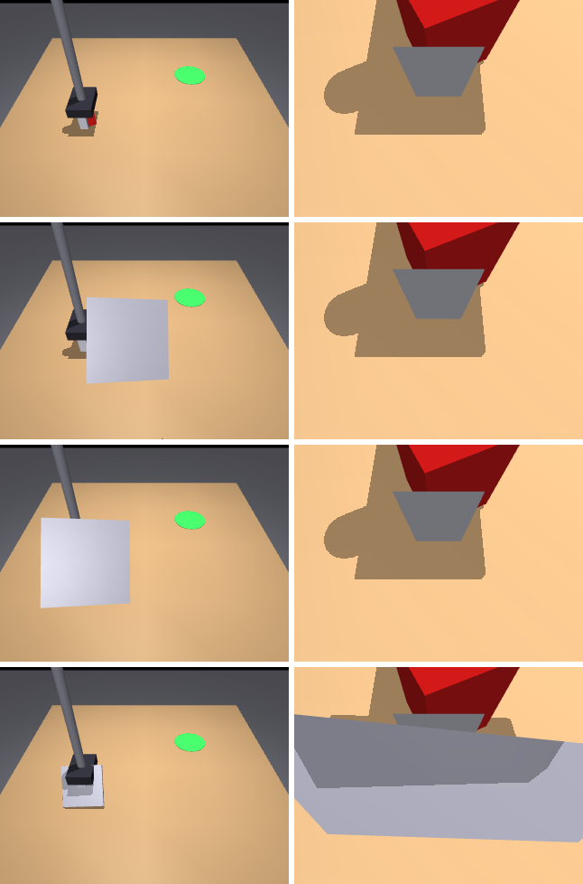

# OccluBench

**A GPU-native benchmark for how vision-language-action (VLA) policies cope when a physical object moves into a camera's view mid-episode.**

Policies see only RGB from a **wrist** camera and a **third-person** camera, plus proprioception. During an episode, a real
simulated object (a mocap plate, rendered by every camera) slides into the line of sight of one camera, hides a calibrated
fraction of the task object, holds, and slides out. Every perturbed rollout is paired with a clean rollout from the
identical initial state, and results are reported with bootstrap 95% confidence intervals.

> **Status: v0 scaffold.** The task, occluder, condition grid, paired runner, metrics, two reference policies and CPU tests
> work. The MuJoCo Warp backend runs (tested on Warp's CPU device) but has not yet been benchmarked on an NVIDIA GPU, and no
> VLA has been evaluated yet. See [Roadmap](#roadmap).



*Rows: clean; third-person 50% target (75% achieved at 64px coverage resolution); third-person 100%; wrist 100%.
Left: third-person camera. Right: wrist camera. CPU renderer.*

## Why this benchmark

Most VLA benchmarks already feed policies cameras plus proprioception, so "camera-only" is not new. What is new here:

1. **A moving, physical occluder introduced mid-episode.** Not a static occluder present from reset, not an image-space
   mask, and not a dropped camera feed. Because it is a physical object, it can also partly block the *other* camera;
   OccluBench measures that leakage (`coverage_other`) instead of hiding it.
2. **A factorial grid of camera × severity × onset** (plus duration). Severity is calibrated per episode, by bisection on
   segmentation renders, to a target fraction of the task object's pixels hidden in the chosen camera.
3. **Paired, seeded rollouts at GPU scale with CIs.** Clean and perturbed rollouts share the same seed and initial state.
   The paired scoring follows MAIL-Bench (arXiv:2609.35003). The physics and renderer run on MuJoCo Warp so that thousands
   of pairs per cell are affordable.

### Positioning

| Work | What it perturbs | Mid-episode? | Physical occluder? | Camera × severity × timing grid | Sim | Paired + CIs |
|---|---|---|---|---|---|---|
| LIBERO-plus ([2510.13626](https://arxiv.org/abs/2510.13626)) | layout/distractors, camera pose, init state, language, light, texture, sensor noise | no | no | no | LIBERO (CPU) | no |
| LIBERO-PRO ([2510.03827](https://arxiv.org/abs/2510.03827)) | objects, init states, instructions, environments | no | no | no | LIBERO (CPU) | no |
| LIBERO-Occ ([2606.10862](https://arxiv.org/abs/2606.10862)) | scene-induced occlusion, light/medium/heavy | no (placed at reset) | yes, static | severity only | LIBERO (CPU) | no |
| LIBERO-VPro ([2609.24350](https://arxiv.org/abs/2609.24350)) | masking (25–100%, 4 temporal schedules), blackout/noise, staleness, view loss, cross-view contradiction | yes | no (masking) | partial | LIBERO (CPU) | no CIs reported |
| MAIL-Bench ([2609.35003](https://arxiv.org/abs/2609.35003)) | camera-group loss (wrist / third-person / all) at 30/45/60% of completion | yes | no (dropout) | camera × timing | RoboCasa365 | yes (bootstrap) |
| BAVO-Bench ([2609.37292](https://arxiv.org/abs/2609.37292)) | stage / random-time occlusion with active viewpoint recovery | yes | — | no | AV-ALOHA (bimanual) | — |
| MIKASA-Robo-VLA ([2610.00604](https://arxiv.org/abs/2610.00604)) | memory: cues hidden before the action that needs them | yes | task-specific | no | ManiSkill 3 | — |
| **OccluBench (this)** | moving physical occluder in front of one camera | **yes** | **yes, moving** | **camera × severity × onset (× duration)** | **MuJoCo Warp (GPU) / MuJoCo (CPU)** | **yes** |

"—" means not characterised here. These rows summarise each paper as we read it; corrections are welcome via issues.

## Install

```bash
pip install -e ".[dev]"            # CPU: mujoco + numpy, plus pytest/ruff/pillow
pip install -e ".[dev,warp]"       # + MuJoCo Warp (GPU physics and batch renderer)
```

CPU rendering needs an OpenGL backend: `MUJOCO_GL=egl` with a GPU, or `MUJOCO_GL=osmesa` (`apt install libosmesa6`) on
headless CPU machines.

## Quick start

```python
from occlubench import OccluEnv, Condition, condition_grid, run_paired, summarize
from occlubench.metrics import format_table
from occlubench.policies import ColorCuePolicy

conds = condition_grid(cameras=("third_person", "wrist"), severities=(0.5, 1.0), onsets=(0.0, 0.15))
records = run_paired(ColorCuePolicy, conds, seeds=range(32), n_envs=16, image_size=(64, 64))
print(format_table(summarize(records)))
```

Or from the command line: `python scripts/run_grid.py --policy colorcue --seeds 32 --n-envs 16`.

### Environment API

* `OccluEnv(n_envs, horizon=200, image_size=(96, 96), physics="cpu"|"warp", render="cpu"|"warp"|"none")`
* `reset(seeds, conditions)` → `obs`; `step(actions)` → `obs, done, info`
* `obs["rgb"]["third_person"]`, `obs["rgb"]["wrist"]`: `(N, H, W, 3)` uint8. `obs["proprio"]`: `(N, 5)` tcp xyz, finger
  opening, grip command.
* Action `(N, 4)`: absolute tcp target `(x, y, z)` in metres plus grip in `[-1, 1]` (+1 closes).
* `info["success"]`: the cube rests within 5 cm of the goal centre. `env.success_step` records the first success step.
* `env.privileged()` returns ground-truth state, for the scripted oracle and for scoring only. Submissions must not use it.
* `env.camera_calibration(cam)` returns intrinsics and extrinsics, as a calibrated real rig would provide.

### Conditions

`Condition(camera, severity, onset, duration)`:

* `camera`: `"third_person"`, `"wrist"`, or `"none"` (clean).
* `severity`: target fraction of task-object pixels hidden in that camera.
* `onset`, `duration`: fractions of the horizon.

The occluder slides in over 8 control steps, holds for `duration`, and slides out. The achieved coverage is recorded per
episode. Coverage is measured with segmentation renders at 64×64 by default, so achieved values are quantised (for
example, a 50% target can land at 75%).

### Metrics (per condition, 95% percentile bootstrap over seeds)

| Metric | Definition |
|---|---|
| `paired_drop` | mean(clean success − perturbed success) over paired seeds |
| `conditional_success` | P(perturbed success \| clean success) (MAIL-Bench-style) |
| `recovery_steps` | mean extra steps to success (perturbed − clean) when both succeed |
| `coverage`, `coverage_other` | achieved hidden fraction in the targeted camera, and leakage into the other camera |

## Reference policies

* `ScriptedOracle` uses privileged state. It is blind to occlusion by construction, so its paired drop should be 0. It is
  a pipeline check, not a baseline. It solved 32/32 seeds in a local check; the tests assert 4/4.
* `ColorCuePolicy` uses pixels and proprioception only, and is not learned. It finds the red cube in one camera by colour
  thresholding and back-projection, then runs a pick-and-place script. With `memory=False` it waits while the cube is
  hidden. It gives the grid a non-trivial signal on CPU.
* `OpenVLAOFTPolicy` is an interface stub (no weights, not functional in v0). The docstring gives the planned
  observation and action mapping.

## GPU runs (NVIDIA Brev, H100 / A100)

```bash
# on an NVIDIA Brev H100 80GB or A100 80GB instance (Ubuntu + CUDA driver)
git clone https://github.com/dundysm/occlubench && cd occlubench
pip install -e ".[dev,warp]"
python scripts/smoke_test.py --n-envs 64 128 256 512 --physics warp --render warp --image 128 128
nvidia-smi --query-gpu=name,memory.used,memory.total --format=csv
```

`smoke_test.py` prints env-steps/s, host peak RSS and GPU memory for each `n_envs`. Measured on a CPU-only box:
~23 env-steps/s with CPU rendering at 96×96 (two cameras), and ~320 env-steps/s for physics only. No GPU numbers have been
measured yet.

Known v0 limitations of the Warp path:

* State is mirrored to the host every control step, for occluder placement and success checks. This is correct but not yet
  fast.
* Coverage calibration uses the CPU segmentation renderer.
* The Warp ray tracer does not draw sites or shadows like the CPU renderer does.

Moving these onto the device is the first GPU milestone.

## Scene

`occlubench/assets/tabletop.xml` is self-authored and MIT-licensed. It contains:

* a Cartesian x/y/z gantry with a two-finger parallel gripper (a simple arm, not a real robot model)
* a red 4 cm cube with a seeded pose and a green goal disc on a table
* a fixed `third_person` camera and a `wrist` camera mounted on the hand
* a collision-free mocap occluder plate

No third-party assets are vendored. A Franka/Panda variant using MuJoCo Menagerie as a fetched dependency is on the roadmap.

## Development

```bash
MUJOCO_GL=osmesa pytest -q      # 19 tests; the Warp test runs if mujoco-warp is installed (CPU device is fine)
ruff check . && ruff format --check .
python scripts/render_docs.py   # regenerates docs/images
```

CI (GitHub Actions) runs ruff and the CPU tests on every PR. Example CPU grid output: [docs/results_v0_cpu.md](docs/results_v0_cpu.md).

## Roadmap

- [ ] **v0.1 GPU path:** keep occluder placement, coverage (Warp segmentation) and success on device. Benchmark H100/A100
      throughput and memory against `n_envs` and resolution.
- [ ] **Realistic embodiment:** Franka Panda (Menagerie, fetched) with an OSC controller; LIBERO-style tasks (pick-place,
      drawer, stacking).
- [ ] **Occluder families:** world-fixed occluders (for example a person or arm passing by), moving clutter, and partial
      transparency. Static (LIBERO-Occ-style) and dropout (MAIL-Bench-style) controls are included for comparison.
- [ ] **Demos:** a GPU scripted-demo generator, including occlusion-during-demo variants, exported to LeRobot/RLDS.
- [ ] **Baselines:** OpenVLA-OFT and pi0/pi0.5 fine-tuned on OccluBench demos, plus wrist-only and third-person-only
      ablations.
- [ ] **Protocol and leaderboard:** frozen seed sets, ≥1,000 pairs per cell, a JSONL results schema, and a hosted
      leaderboard.
- [ ] **Validation:** CPU MuJoCo vs MuJoCo Warp parity on success rates, and a small real-robot occlusion study.

## Citation

```bibtex
@software{occlubench2026,
  title  = {OccluBench: A GPU-Native Benchmark for VLA Robustness to Moving Physical Occluders},
  author = {Pasupuleti, Dundy},
  year   = {2026},
  url    = {https://github.com/dundysm/occlubench}
}
```

Please also cite the works OccluBench builds on: MuJoCo / MuJoCo Warp, and MAIL-Bench (arXiv:2609.35003) for the paired
camera-interruption protocol.

## License

MIT. See [LICENSE](LICENSE).
